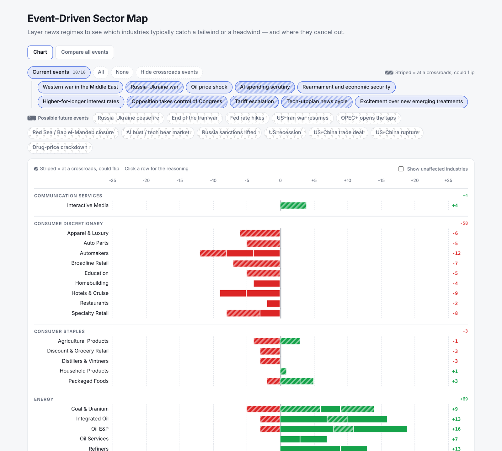
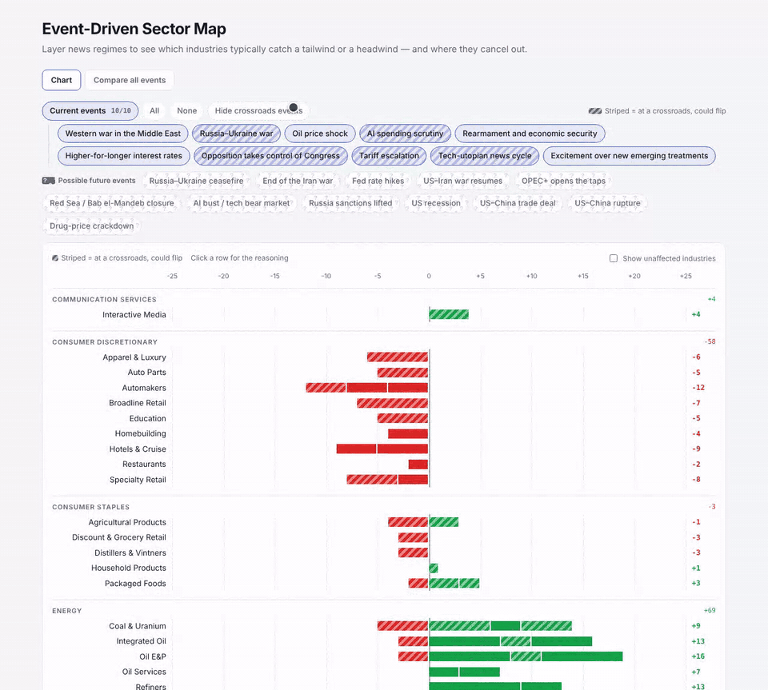
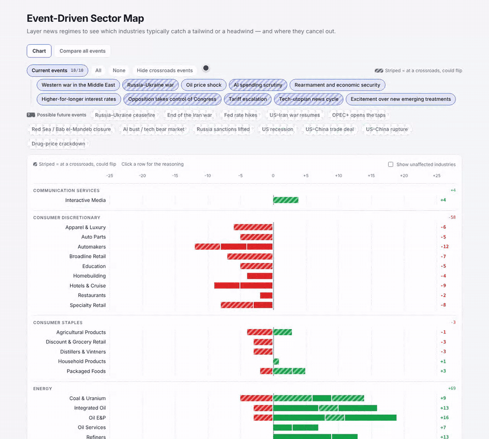
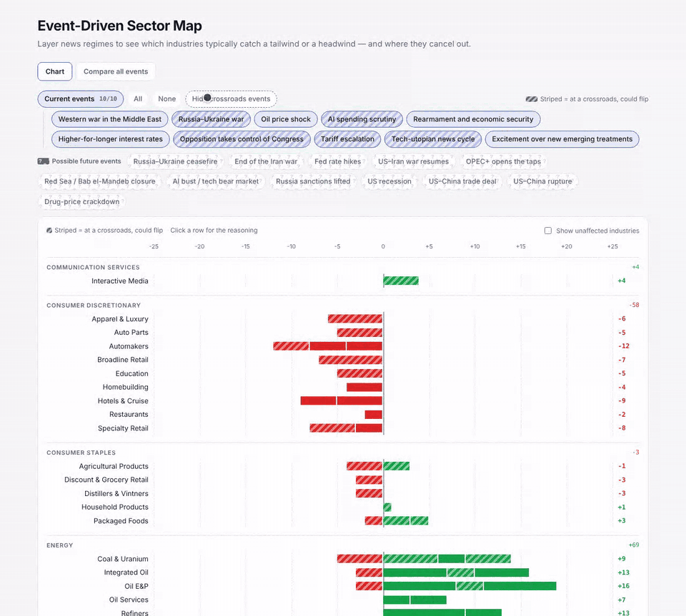
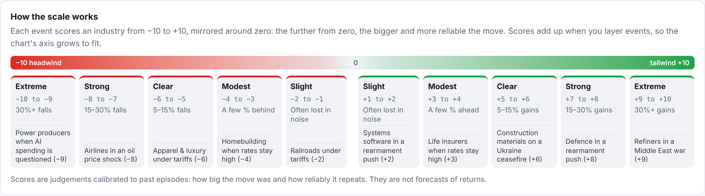
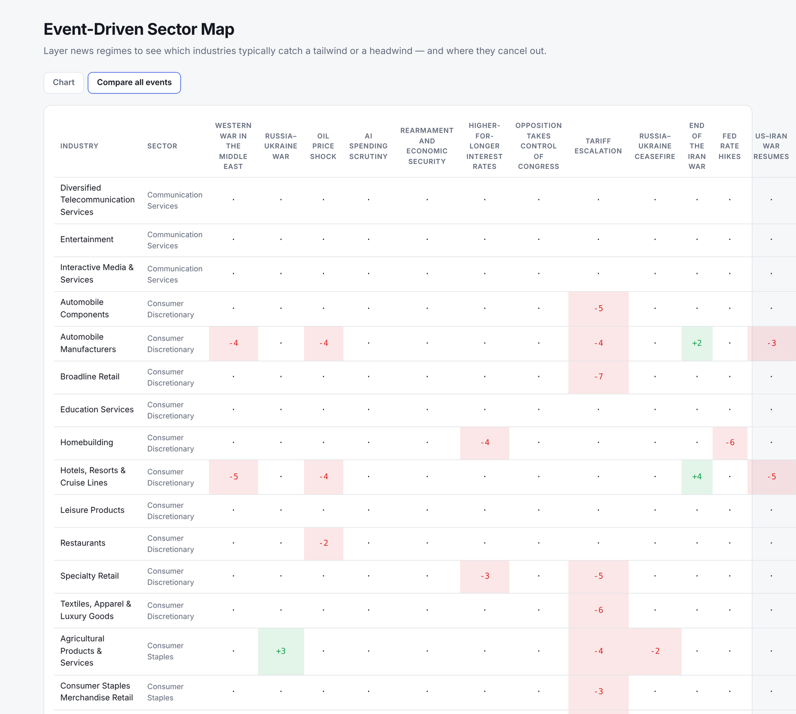
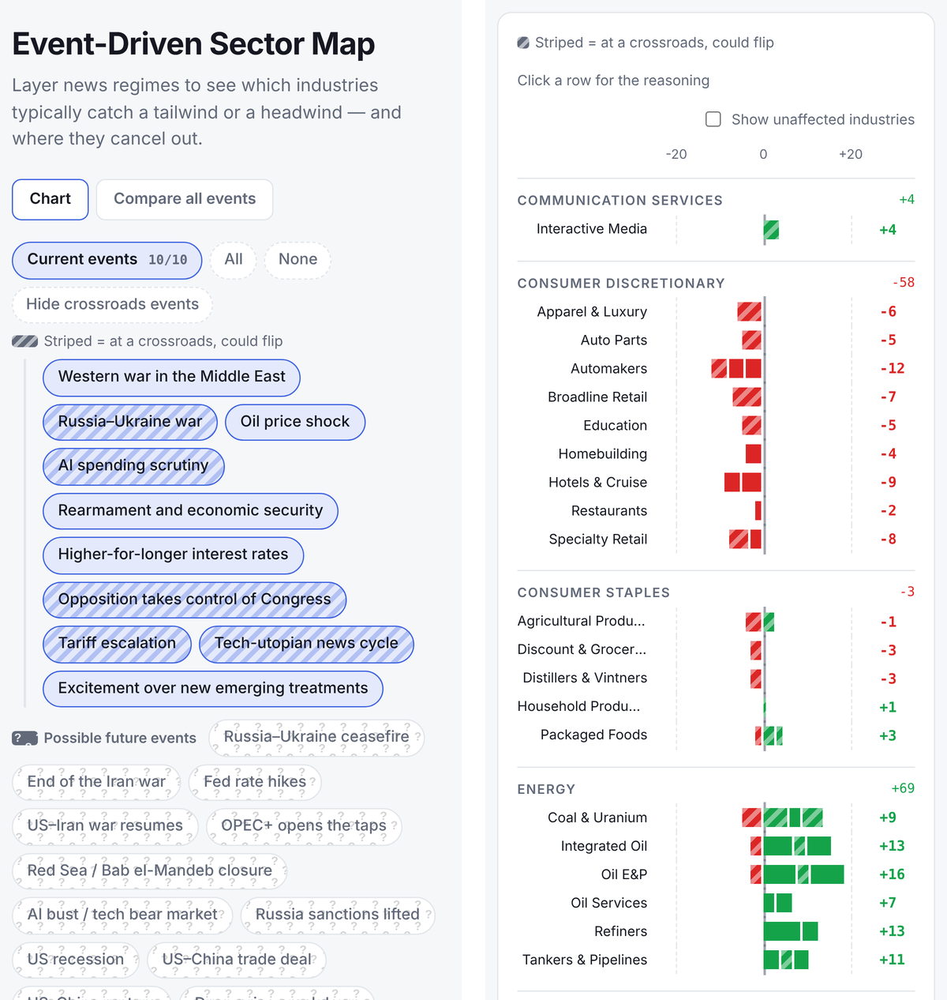

# Event-Driven Sector Map

**Layer the news. See which industries win, which lose, and where the effects cancel out.**

An interactive map of how major news events, like wars, oil shocks, rate decisions, tariffs and AI hype cycles, tend to push different stock-market industries up or down. Switch events on and off, stack them together, and the chart adds up every effect into one net score per industry.

---

## Layer events and watch the chart rebuild

Each event you switch on adds its own bar segment to every industry it touches. Green helps, red hurts, and the number on the right is the net. Here a Middle East war, an oil price shock, a rearmament push and higher-for-longer rates are added one by one:

## Every score comes with its reasoning

Click any industry to see why it moves: the score for each active event, what drives it, which companies are most exposed, and which switched-off events would also move it.

## Test what could change

Possible future events (peace deals, rate hikes, a tech bear market, an OPEC supply flood) have a **?** pattern so they never get mixed up with what's happening now. Switch one on to see how today's winners hold up. Here two peace deals wipe out most of the oil and defence rally:

**Striped** events are at a crossroads: they're happening now but could flip either way. One click hides them all, so you can see the picture built only on the firmer events.

## One scale, mirrored around zero

Every event scores each industry from −10 to +10. The further from zero, the bigger and more reliable the move has been in past episodes. Each band comes with a real example from the map.

## Compare all events at once

A grid view puts every industry against every event, so you can spot the industries that win (or lose) almost regardless of what happens next.

## Works on mobile

---

## What's in it

- **22 events**: 10 current (Middle East war, Russia–Ukraine war, oil price shock, AI spending scrutiny, rearmament, higher-for-longer rates, a change of control in Congress, tariff escalation, a tech-utopian news cycle, excitement over new medical treatments) and 12 possible future ones
- **74 industries** across all 11 GICS sectors, using the official GICS industry names
- **Sector totals** beside every heading, sorted A–Z
- **"Show unaffected industries"** to see the full universe, not just the movers

## A note on the numbers

Scores are judgements calibrated to how big past moves were and how reliably they repeated. They describe tendencies, not forecasts, and they're a starting point for research, not a buy or sell signal.

---

*A personal research tool. The page itself is private; this repo is its showcase.*
